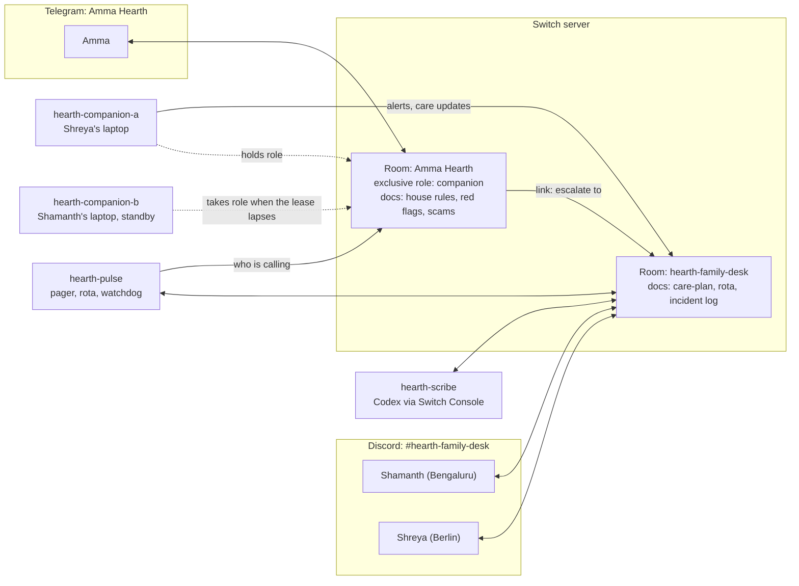
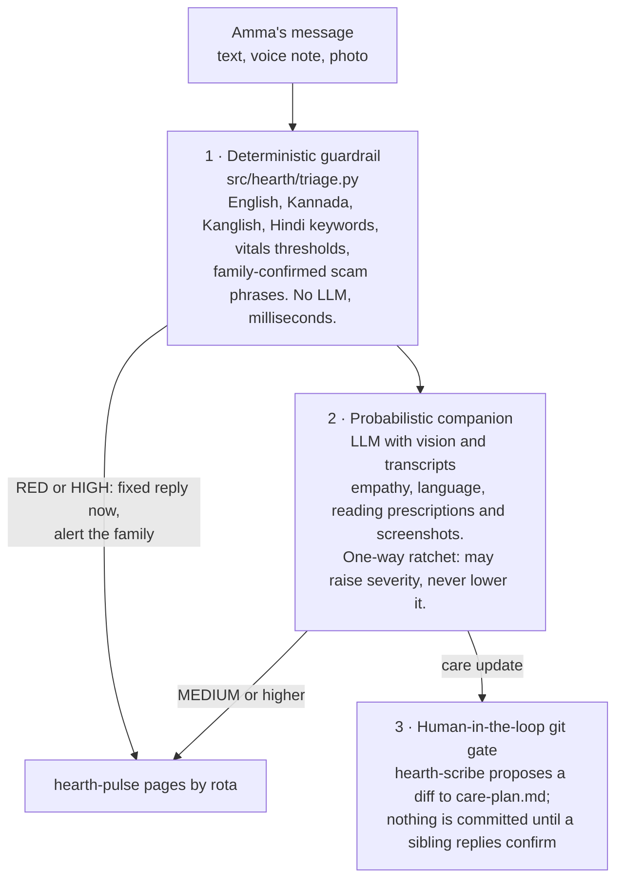

# Hearth

**An on-call rotation for the people who raised you.**

Hearth is a family care workflow built on [Switch](https://github.com/sandbox-quantum/switch). A parent who lives alone chats with a warm companion agent in a Telegram group, in her own mix of Kannada and English, by text or voice note. Her children work from a Discord channel. When something is wrong (a fall, chest pain, a "CBI officer" demanding money on a video call), Hearth pages the sibling on duty, re-pages the next one if nobody acknowledges, and tells the parent who is calling her. A scribe agent keeps the family's care book in git and changes it only after a sibling confirms.

Built for the Flip the Switch hackathon, Track 02: Best Personal or Creative Workflow.

> Switch's own demo is an incident room for a failing checkout. Hearth applies the same SRE toolkit (paging, heartbeat leases, follow-the-sun rotations, runbooks in git) to the system that matters most.

> **What you'll see in the 2-minute demo** ([script](docs/DEMO.md))
>
> **Act I: the "digital arrest" scam.** Amma writes in Kanglish about a "CBI video call". The deterministic triage replies in milliseconds ("idu scam… duddu kalisbedi"). Bengaluru misses the page; after 45 seconds Berlin is paged, acks, and Amma is told "Shreya nimge eega call maadtare".
>
> **Act II: zero-downtime failover.** The laptop answering Amma goes offline. Its connection stops answering Switch's pings, Switch releases the `companion` role lease 6 seconds later, and the standby companion takes the role, reads the room history and carries on. Amma never notices.
>
> **Act III: prescription to git commit.** Amma photographs a new prescription. The companion reads it, the scribe posts a `diff` against `care-plan.md`, and a sibling replies `confirm` to commit it.

## Why

- 63 million Americans are family caregivers, nearly 1 in 4 adults ([AARP and NAC, 2025](https://www.aarp.org/press/releases/2025-07-24-new-report-reveals-crisis-point-for-americas-63-million-family-caregivers.html)).
- In India, Union Home Ministry data shows 1,03,488 senior citizens lost nearly ₹4,000 crore to cyber fraud ([Times of India](https://timesofindia.indiatimes.com/city/noida/1-in-every-5-cyber-fraud-victims-in-noida-a-senior-citizen/articleshow/135126948.cms)).
- Families coordinate this in a noisy group chat where nobody owns the job. Hearth gives the job an owner at every hour, and a record.

## What it looks like

| Who | Where | What they do |
|---|---|---|
| Amma, the parent | Telegram group with the Switch bot | Talks normally, by text or voice note. Sends photos of prescriptions and screenshots of suspicious messages. |
| Her children | Discord channel `#hearth-family-desk` | Get paged by rota, reply `ack`, confirm care-plan changes, teach Hearth new scams. |
| `hearth-companion-a` / `-b` | Custom Python agents, one per laptop | One holds the exclusive `companion` role and answers Amma; the other waits and takes over if that laptop goes offline. |
| `hearth-pulse` | Custom Python agent, no LLM | Turns alerts into incidents, pages by follow-the-sun rota, re-pages, posts shift handoffs, runs the scam shield, keeps the incident log, watches that a companion is online. |
| `hearth-scribe` | Codex or Claude Code, run by Switch Console | Keeps the care book in git, proposes changes as diffs, applies them after a sibling confirms, writes doctor-visit briefs and the weekly digest. |



## How Hearth uses Switch

Hearth would not work without Switch. Every arrow above is a Switch room, role, document, link or protocol call.

| Switch feature | Where Hearth uses it |
|---|---|
| Rooms on two messaging apps (Telegram and Discord bridges) | Amma's chat and the siblings' desk are different apps on one server, with the same agents in both. |
| Exclusive roles with heartbeat leases | The `companion` role. When the holder's connection stops answering pings, Switch releases the lease and the standby companion takes it. |
| Agent protocol (WebSocket events, HTTP operations) | `hearth-pulse` and both companions are custom clients (`src/hearth/switch/client.py`): register, connect, answer pings, `connect_to_room`, `assume_role`, `list_roles`, `send_targeted_message`, `read_context`, document operations, media download and upload. |
| Bring your own agent | The scribe is a Codex (or Claude Code) agent run by Switch Console, working in the care book folder with git. |
| Room instructions | Written from `room/parent-room.md` and `room/family-room.md`, so any agent that joins either room is briefed. |
| Room documents as shared memory | `hearth-house-rules`, `hearth-red-flags`, `hearth-rota`, `hearth-incident-log` and `hearth-scam-patterns` (written by pulse, which grows when the family confirms a new scam), and `care-plan` (written by the scribe; only a document's author can change it). |
| Cross-room reads | Pulse reads Amma's room history with `read_context(room_id=…)` to write shift handoffs, while its connection stays on the family desk. |
| Room links | Amma's room links to the family desk ("escalate to"), and back. |
| Addressing and handoffs by mention | Alerts and care updates are messages that address the scribe or people; pulse pages with targeted messages so Discord notifies the person. |
| Templates | `templates/family-desk.template.yaml` creates the family desk room; `hearth-setup --bridge Discord` runs it through `create_room_from_yaml`. |

## The safety sandwich

Every message from Amma passes through three layers, in this order. Each layer can make the response more careful; none can make it less careful.



Other guarantees:

- Agents never diagnose, suggest a dose, change a medicine, move money, or ask for an OTP or bank details (`room/docs/house-rules.md`).
- An LLM outage can't delay an emergency or scam reply: those are fixed text, sent before the LLM is asked anything.
- A voice note that can't be transcribed is never dropped: it goes to the family as MEDIUM, with the audio attached, for a person to listen to.
- Agent messages never count as confirmation of a care-plan change.
- The scribe works in the care book folder only, so it never sees Hearth's API keys in `.hearth/`.
- The data in this repository is fictional. Real use needs the parent's consent.

## The workflows

**Alerts and paging.** Possible emergencies (RED) get an immediate fixed reply telling Amma to call 108 or a neighbour, and every sibling is paged at once. Scams (HIGH) get an immediate "don't pay, don't share the OTP, hang up". Then pulse runs the incident:

1. `ESC-17` is posted in the family desk, addressed to whoever is first in the follow-the-sun order.
2. No `ack` before the timeout (5 minutes for HIGH, 45 seconds in demo mode): pulse pages the next person, then everyone.
3. `ack 17`: paging stops and pulse tells Amma "Shreya nimge eega call maadtare" (Shreya is calling you now).
4. `resolved 17: she hung up, nothing shared`: closed and written to `hearth-incident-log`.

**Failover.** Both companions connect to Amma's room. Only the `companion` role holder answers. When the holder goes offline (a closed laptop, or `Ctrl+C` in its terminal), its connection stops answering Switch's 2-second pings; 6 seconds later Switch releases the lease, the standby's next check takes the role, and it posts "🔁 hearth-companion-b took over Amma's chat". If no companion holds the role for 30 seconds, pulse pages the family, because nobody is answering Amma.

**Care updates.** Amma sends a photo of a new prescription. The companion reads it, thanks her, and posts what it read plus the photo to the family desk, addressed to the scribe. The scribe answers with a diff and waits:

````
Proposed change to care-plan.md (ref m-1a2b3c4d, from Dr. Rao's prescription of 4 Nov):
```diff
 ## Medicines
-- Telmisartan 40 mg · 1-0-0 after breakfast · for BP · Dr. Rao
+- Amlodipine 5 mg · 1-0-0 after breakfast · for BP · Dr. Rao (prescription 2026-11-04)
 - Metformin 500 mg · 1-0-1 after food · for sugar · Dr. Rao
```
Is Telmisartan stopped? Reply `confirm m-1a2b3c4d` to commit this to care-plan.md.
````

After `confirm m-1a2b3c4d`, it updates the file and the `care-plan` room document, appends to `decisions.md` with who confirmed, and commits.

**Voice notes.** Parents who are anxious or unwell send voice notes rather than typing. The companion transcribes them (Gemini's native audio input, or any OpenAI-compatible `/audio/transcriptions` endpoint such as Whisper) and runs the transcript through the same triage, so "ede novu aagtide" spoken is as urgent as typed. Alerts quote the transcript and attach her voice note.

**"We have detained your son."** A common scam opener tells the parent one of her children is arrested or hurt and not to call them. When triage sees a caller, a family member and trouble together, the companion replies "don't send money, I'm checking with them", and pulse asks that sibling in Discord to reply `safe`, showing when they were last active there. If they were active in the last 15 minutes, pulse tells Amma right away; when they reply `safe`, pulse tells her "Shamanth chennagiddare, safe aagiddare" and the alert is acknowledged.

**The family's own threat intel.** After resolving a scam, a sibling can reply `learn 17: "your electricity will be cut tonight"`. Pulse adds the phrase to a "Seen in this family" section of `hearth-scam-patterns` in both rooms, and every companion loads it into its deterministic triage within two minutes. The next caller with the same script is flagged without the LLM. Screenshots of suspicious SMS or WhatsApp messages are read by the companion and treated as scams, not care updates.

**Shift handoffs.** When the first person on the rota changes (Bengaluru night becomes Berlin evening), pulse posts a three-line handoff to the incoming sibling, built only from Amma's own messages and the incident book:

```
@shreyabj 🌅 Shift handoff: you're now first on call (18:30 Europe/Berlin). @ms_shamanth is off.
Last 8h with Amma: 5 messages, last at 21:40 her time; BP 128/82; said she took her medicines at 09:10; mentioned pain.
Open incidents: none.
```

`handoff` in the family desk posts one on demand.

**Quiet mornings.** Silence is a signal too. If Amma hasn't written since 5:00 by 10:30, the companion checks in gently ("Amma, kaafi aaytha?"). No answer within 45 minutes raises a MEDIUM `no-signal` alert, which pages the person on duty without the urgency of an emergency.

**Visit briefs and digests.** "@hearth-scribe prep the visit with Dr. Rao on 12 Nov" produces a one-page PDF (`carebook/tools/visit_brief.py`): current medicines, readings since the last visit, how often she mentioned each symptom, and the family's questions. Every evening the companion posts "Today with Amma" for the scribe's log; every Sunday pulse asks the scribe for the weekly digest.

## Run it

Full steps are in [docs/SETUP.md](docs/SETUP.md). These commands work in PowerShell, bash and zsh:

```bash
uv sync
cp .env.example .env                           # Switch URL, registration key, LLM key
cp config/hearth.example.yaml config/hearth.yaml
uv run hearth-companion --check-llm            # which model answers; voice notes on or off
uv run hearth-register --all                   # pulse + both companions
uv run hearth-setup --participants             # rooms, role, documents, links
uv run hearth-pulse                                 # terminal 1
uv run hearth-companion --name hearth-companion-a   # terminal 2 (or a second laptop)
uv run hearth-companion --name hearth-companion-b   # terminal 3, the standby
```

Before that: install Switch Console and run a server, connect Telegram and Discord, create the Telegram group and Discord channel, and create `hearth-scribe` in Switch Console with `agents/scribe/AGENT.md` as its instructions and a copy of `carebook/` as its folder. [docs/SETUP.md](docs/SETUP.md) walks through each one.

The companion uses `gemini-flash-latest` by default and falls back to the pinned `gemini-2.5-flash` if the alias isn't available; set `HEARTH_LLM_MODEL=gemini-2.5-flash` to pin it. Any OpenAI-compatible endpoint works.

No Telegram handy? Type `drill scam high` in the family desk to rehearse the paging loop.

## Repository

```
src/hearth/switch/      Switch agent protocol client (WebSocket + HTTP), room participants
src/hearth/companion/   the companion agent and its prompt
src/hearth/pulse/       hearth-pulse and the idempotent room setup
src/hearth/triage.py    deterministic multilingual triage (layer 1)
src/hearth/incidents.py the paging state machine
src/hearth/rota.py      follow-the-sun on-duty order
src/hearth/handoff.py   shift handoff summaries
src/hearth/learned.py   scam phrases the family confirmed
src/hearth/speech.py    voice note transcription
src/hearth/phrases.py   fixed Kanglish and English messages for the parent
room/                   room instructions, role instructions, shared documents
templates/              the Switch template for the family desk
agents/scribe/AGENT.md  the scribe's instructions for Switch Console
carebook/               the scribe's folder: care plan, logs, decisions, visit brief tool
config/                 example family config
tests/                  unit and end-to-end tests (uv run pytest)
docs/                   setup, demo script, day-one checks, submission checklist
```

## Tests

```bash
uv run pytest -q
```

Unit tests cover the triage, paging state machine, rota, message contract, handoffs, learned phrases, model fallback, transcription, config, room texts and the visit brief. End-to-end tests run pulse and two companions against an in-memory Switch (`tests/fake_switch.py`): setup, paging and acks, the scam and emergency replies, voice notes, the 🛡️ shield, `learn`, handoffs, the quiet-morning check, and the role failover.

## License

MIT. Switch itself is licensed separately by SandboxAQ.
